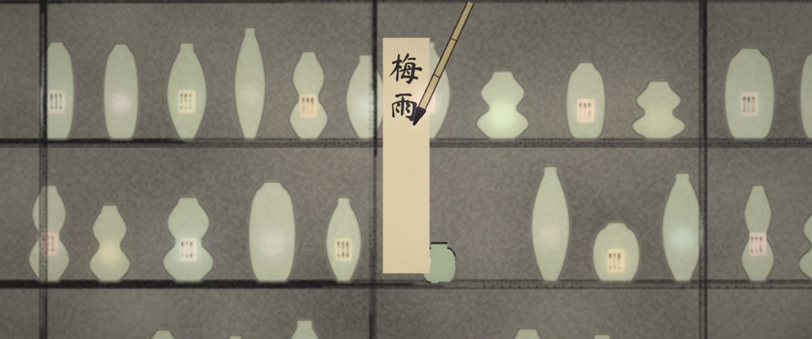
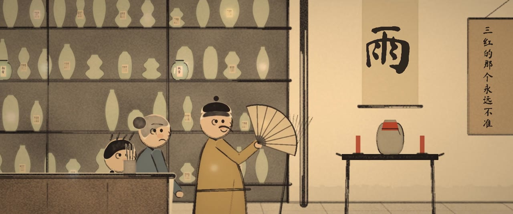
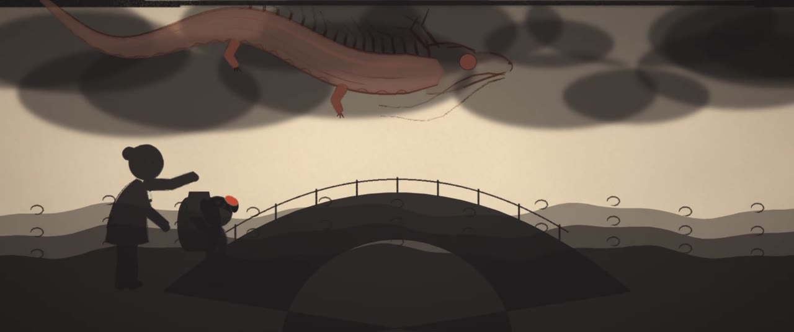
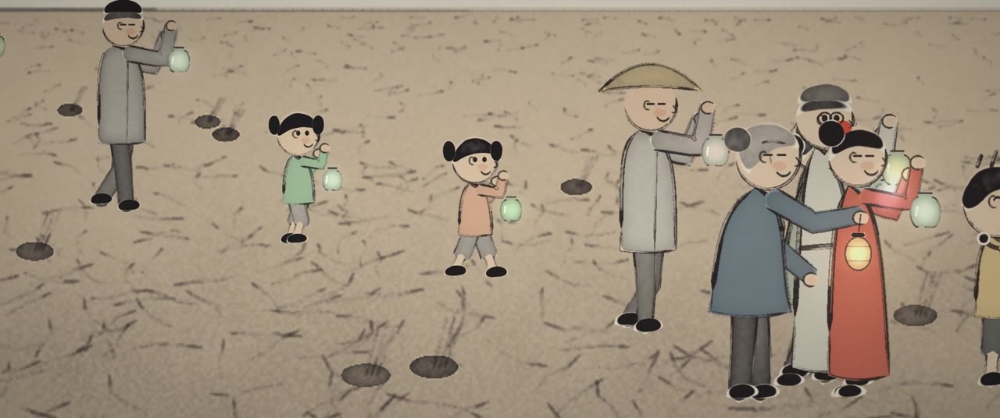

# The Rain Shop 雨铺 — a 60-minute ink-wash film made in pure Python

Granny Yun sells bottled weather in a grey water town. During a long drought, her grandson Xiaoman opens the red jar, and a trapped rain dragon wakes.
The whole town opens every jar to lift the dragon, and the rain and color come back.

The film is Chinese ink wash on rice paper, painted entirely by code (numpy + OpenCV + Pillow): washes with bleeding edges, dry-brush strokes, paper grain, and Feng Zikai-style figures.
Subtitles are 中文 on top and English below. The score (guzheng, dizi, erhu, rain) is synthesized and there are no voices.

| | |
|---|---|
|  |  |
|  |  |

## Layout
| Path | What it is |
|---|---|
| `ink.py` | ink toolkit: paper, `wash`, pressure brush `stroke`, value noise |
| `engine.py` | scene/shot framework, camera, glow, rain, subtitles, grading |
| `chars.py`, `figure.py` | characters (Granny, Xiaoman, Qian, townsfolk, the dragon, Baozi the cloud, Old Ink the cormorant) |
| `town.py`, `sets.py`, `sets_shop.py`, `sets_more.py` | sets: the town, the shop, mudflat, sky, bridge, lane, roofs, city |
| `kit.py` | props: boats, jars, umbrellas, paper slips, walking helpers |
| `sound.py` | music and sound synth (`Mix`, pentatonic notes) |
| `s01.py` … `s13.py` | the 13 scenes (shots, acting, bilingual subtitles, sound) |
| `render.py`, `launch.sh`, `queue.sh`, `finish.sh`, `join_film.sh` | chunked renderer, queue, scene finish, final join |
| `shot01.py`, `sound01.py` | the original 20-second style test |
| `MaShanZheng.ttf` | Ma Shan Zheng font (SIL Open Font License) for titles and subtitles |
| `docs/` | story plan and full script |

## Render
Requires Python 3 with numpy, opencv-python, Pillow and scipy, plus ffmpeg.

```bash
python3 s03.py still test/s03 30 60 90   # test stills of scene 3 at 30, 60 and 90 s
python3 sheet.py test/s03                # contact sheet of those stills
bash launch.sh s03 4                     # 4 render workers, 10-second chunks -> out/s03/
bash finish.sh s03                       # sound + join -> scenes/s03.mp4
bash queue.sh                            # render every scene listed in queue.txt, in order
bash join_film.sh                        # join all 13 scenes -> final/The_Rain_Shop.mp4
```
On first run the sets build their static layers (`static01.npz`, `cache/`). These files are big and generated, so they are not kept in git.
A scene takes about 30 to 80 minutes on 4 cores.
